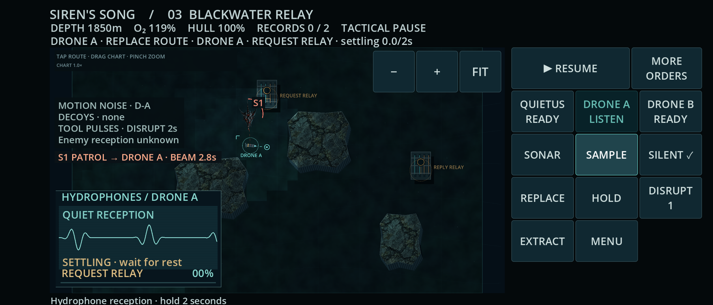

# Siren’s Song · live phone dashboard

**[Latest chapter APK ·20de5cd](https://github.com/pemunson90-cmd/Siren-s-Song/actions/runs/39266427532/artifacts/12193674811)** · [successful Android run39266427532](https://github.com/pemunson90-cmd/Siren-s-Song/actions/runs/39266427532). All4ZIP/APK/certificate checks and48final images are inspected. **Cover resume is entirely black**, so this is scoped chapter/presentation evidence, not a complete lifecycle/visual pass. [Exact review](validation/android-39266427532/ARTIFACT_REVIEW.md) · [Install guide](PLAYTEST_ANDROID.md).

Preserved successful inspected fallback: [0afe5fc APK](https://github.com/pemunson90-cmd/Siren-s-Song/actions/runs/39251216827/artifacts/12186710188). Fully inspectedf1ea536/runtime92625ac and later acoustic/density baselines remain preserved. Only the user determines satisfaction and ends the Gauntlet; development continues through checkpoints.

## Actual Android chapter

[Inner reception](validation/android-39266427532/screenshots/inner-blackwater-receiving.webp) · [Earned request gallery](validation/android-39266427532/screenshots/cover-blackwater-request-gallery.webp) · [Inner gallery](validation/android-39266427532/screenshots/inner-blackwater-request-gallery.webp)

Blackwater now offers quiet-close sampling or audible standoff replay, with distinct request/reply discoveries. Actual images show the full settling hint and readable large caption/BACK controls; the cover caption needs scrolling and fine poster annotations remain smaller. Fixture-assisted request/restore/gallery checks do not prove earned full-chapter/campaign completion. [Desktop audible sampling](validation/production/blackwater-motion-review/challenger-active-reply.mp4) can draw damage; [idle observation](validation/production/blackwater-motion-review/challenger-idle-final.mp4) loses a drone.

Reviewed [equipment clarity](reviews/2026-10-19-loadout-clarity-review.md) explains finite stock before launch and preserves active equipment on resume. Cost: more scrolling. Clarity does not establish balanced choices; ordinary scripted missions leave abundant oxygen, and exploration-paced equipment value remains open.

## Steering under threat

Watch [baseline](validation/production/navigation-emergency-experience/motion/baseline-emp.mp4) versus [reviewed steering](validation/production/navigation-emergency-experience/motion/challenger-emp.mp4). Same ordinary snapshot,16seconds, emergency replacement at movie+1s and **one EMP spent from stock3**. Baseline stops against terrain/end hull27%; challenger keeps the route/end hull85%. Neither is a mission win or safe escape. [Unprotected challenger](validation/production/navigation-emergency-experience/motion/challenger-noemp.mp4) still loses at movie+8.7s.

This steering is integrated locally, **absent from20de5cd APK**. Turning still costs about1.1s in the matched stationary departure; momentum can still cause collisions. Fixed2× framing/no camera follow and scripted inputs do not establish thumb comfort. [Independent experience](reviews/2026-10-19-navigation-departure-experience.md) · [Separate regression](reviews/2026-10-19-navigation-departure-regressions.md).

Reviewed tactical source **0d1b390** adds PLAN ROUTE, terrain acoustic arrivals/own-speed footprint and physical snaring torpedoes to the existing steering/Well/archive work. [Actual cover orders](validation/production/tactical-core-milestone/cover-secondary.png) · [Paused planner](validation/production/tactical-core-milestone/cover-planner.png). These are desktop420dpi fixtures, newer than the accepted APK above; combined native39288954098 passed all source tests and built the APK, then failed native smoke. [Artifact review](validation/android-39288954098/ARTIFACT_REVIEW.md) verifies the saved signing identity and readable cover controls. The failed run stopped before inner/lifecycle checks, so it is not promoted.

[Later native39276951740](validation/android-39276951740/ARTIFACT_REVIEW.md) **failed** on gallery scroll overshoot. Actual cover/inner same-resume screenshots are readable, but the gallery sequence is incomplete and its signing certificate changed, so that APK is not promoted. The original accepted debug key is now permanently saved in Git and required by every build; no silent regeneration.

## Work already underway

- **Physical torpedo and route programming:** integrated and published, including noisy flight/snare and Quietus per-waypoint speed. Drones remain fixed-speed. Clustered-target tap correction is reviewed and locally integrated: explicit S# FIRE guides, stable intended contact and no spending on ambiguous body taps.
- **Terrain acoustics:** integrated speed footprint and geometry arrivals. Thermal staging is reviewed and integrated: a limited cold-front waiting window costs time and passive contact information, preserving camera/terrain and visible beam warnings. Reflections and travel time remain open.
- **Paused route planner:** reviewed pan/pinch and full-size +/−/FIT support selected-point editing. Native modal diagnostics/probe are next.
- **Currents:** prototype rejected:1.6s travel gain did not justify62.4m HOLD drift. No flow controller is in the game.
- **Native validation:** run39288954098 passed signing/full tests/APK build but failed native smoke; all four artifacts and14cover views are inspected. Failure was a stale secondary checklist, now corrected with targeted tests and original-metrics replay; inner/lifecycle checks remain unreached. No retrieval rerun or broad acceptance claim.

## Remaining quality bar

[Independent adherence audit](reviews/2026-10-19-gauntlet-adherence-progress-audit.md) found legitimate bounded gains and over-certification risk. Tests verify contracts; actual play evidence, criticism and retained failures guide the next improvement. Mandatory Blackwater cadence was rejected after adding about5s of waiting without demonstrated benefit.

Earned full native campaign/finale, physical Fold7 folding/cutouts/OS pinch/thumb comfort, sustained heat/frame performance, human listening and newcomer comprehension remain open. Experimental finale ancestry is not promoted. No passing build/review/checklist ends development.

[Workbench](WORKBENCH.md) · [Exact continuation](CONTINUATION.md) · [Baseline/experiments](BASELINE_AND_EXPERIMENTS.md) · [Model record](MODEL_USAGE.md) · [Source authority](SOURCE_AUTHORITY.md)
