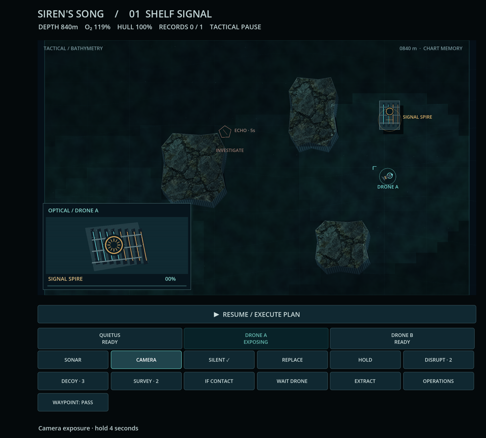

# Siren's Song · current checkpoint

**[Download the current Android build](https://github.com/pemunson90-cmd/Siren-s-Song/actions/runs/39202066103/artifacts/12164418637)** · [Install/update guide](PLAYTEST_ANDROID.md)

Development build **93b8631**, verified 19 October 2026. The first mission completed on the Android emulator through ordinary touch commands, including camera capture, extraction and saved campaign progress after kill/restart. Cover and unfolded landscape layouts/lifecycle passed. This is a development baseline, with physical Fold7 and complete native campaign validation still open.

## What improved

- **Cold Foundry has a distinct encounter:** physical industrial terrain, two different optical discoveries, an explained carrier response and recoverable extraction. Its independent review supports that bounded gain.
- **The native audio crash is fixed:** generated PCM loops now end on a valid sample. Android sustained travel crossed the former crash boundary, then completed the camera/objective sequence without fatal, engine or script errors.
- **Progress survives restart:** the installed app restored Shelf Signal as recovered and Split Channel as available. Development signing matches earlier builds, permitting compatible updates that retain saves.

## See the current game

Actual Android camera exposure from the verified build:

[Android success screen](validation/android-39202066103/inner-mission-completed.png) · [Restarted campaign archive](validation/android-39202066103/inner-campaign-restored.png)

Cold Foundry: [desktop encounter clip with mixed audio](validation/production/foundry/response-live.mp4) · [furnace discovery](validation/production/foundry/furnace.png) · [departure record](validation/production/foundry/archive_cradle.png). These Foundry captures are desktop evidence, not Samsung screenshots or a native mission-completion claim.

## What the checkpoint proves

[Run 39202066103](https://github.com/pemunson90-cmd/Siren-s-Song/actions/runs/39202066103) passed **88 core + 176 runtime checks**, strict native error checks, both screen profiles, native input/orders/pause, background/resume, process death/restoration and one ordinary mission completion. [Raw evidence and exact signing/hash](validation/android-39202066103/README.md).

Baseline source: **93b8631**; audio/game fix **cb8c6f9**; Foundry content **322d23c**. New local work is a challenger until its evidence supports replacing this baseline. Emulator timings are not phone performance measurements.

## Experiments kept visible

- Earlier exposed/rushed Foundry strategies failed; a staged finite-defense route succeeded. [Original comparisons and failed attempts](validation/production/foundry/README.md).
- A narrow authored passage could not fit the navigation grid and was widened. Movement and sight now share the factory footprint.
- The independent critic found the final scripted Foundry decoy redundant in its controlled comparison. We retain that result and do not claim a demonstrated diversion benefit from that tactic. [Review and reproduction](reviews/2026-10-19-cold-foundry-critique.md).

## Weaknesses and next work

**Zoom, pan and friendlier touch controls are next.** Small craft, crowded threat labels and equally weighted commands make phone-scale decisions harder than they should be. The prototype's dimensions and interface are not constraints. Touch changes must preserve deliberate tactical pause and reliable route replacement, with cover/unfolded gesture evidence.

Physical Fold7 cutouts/hinge/rotation, comfort, real device performance/heat, subjective audio, newcomer comprehension and all six missions on installed Android remain open. Independent review also identifies overlapping encounter labels and a factory facade that could integrate better with its monumental surroundings. Passing checks do not close these experience gaps.

## Follow the work

[Current workbench](WORKBENCH.md) · [Next action / continuation](CONTINUATION.md) · [Independent review](reviews/2026-10-19-cold-foundry-critique.md) · [Source authority](SOURCE_AUTHORITY.md) · [Model/usage record](MODEL_USAGE.md)

The Gauntlet continues until the user chooses to stop. Explore freely; this page is a reference, not a recurring feedback or approval gate.
