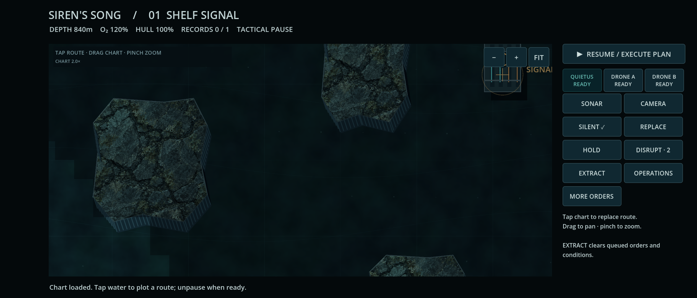

# Siren's Song · current checkpoint

**[Latest numerically tested APK · b809501](https://github.com/pemunson90-cmd/Siren-s-Song/actions/runs/39229219785/artifacts/12176549560)** · [Previously inspected fallback · f1ea536](https://github.com/pemunson90-cmd/Siren-s-Song/actions/runs/39205478335/artifacts/12165339461) · [Install/update guide](PLAYTEST_ANDROID.md)

Fully inspected fallback **f1ea536**, runtime **92625ac**, verified 19 October 2026. Native zoom, drag pan and FIT pass on cover and unfolded landscape layouts without accidental orders or pause changes. Ordinary first-mission camera/extraction completion and saved campaign restoration also pass. Physical Fold7 and complete native campaign validation remain open.

## Current density checkpoint · native gates pass; pixel review pending

Exact **b809501 / run 39229219785 passes the full native numerical/input gate**. Both layouts pass primary/secondary target measurements, Operations/Settings scrolling with unchanged audio values, sticky BACK, zoom/pan/FIT, ordinary Shelf completion/cold restore and the fixture-assisted Well hunter path. Complete hash-checked metric transport resolves the earlier truncated-record blocker. **Current APK bytes and screenshots remain uninspected because artifact access is blocked.** [Exact scope, hashes, artifacts and next retrieval action](validation/android-39229219785/README.md). The UI adds larger controls/text, sticky actions and persistent route intent. [Changes, retained failures and tradeoffs](validation/production/density/README.md) · [Fresh review](reviews/2026-10-19-density-touch-review.md).

Actual **local fixture** views: [cover controls](validation/production/density/captures/cover-primary/full.png) · [unfolded controls](validation/production/density/captures/inner-primary/full.png) · [sticky briefing actions](validation/production/density/captures/cover-briefing/full.png) · [Settings/BACK](validation/production/density/scroll-boundary/captures/cover-settings/full.png) · [16-second planning/page-change clip](validation/production/density/clips/cover-planning.mp4). These are desktop captures, not Android screenshots or proof of finger comfort. [Exact engine transform and independent local audit](validation/android-touch-targets/quantized-viewport/README.md) preserves actual integer viewport geometry and fixture provenance. Work is paused at the artifact-access dependency; no extra CI run is needed to inspect the existing artifacts.

## Retained A gains and prototype evidence

The [original prototype import](source-import/original-prototype-handoff/PUBLISHED_RESULT.md) is published at **8598d5a**, with remote byte/path verification recorded at **178ea2d**. All seven original files, ZIP and both addenda match. [The mechanics audit](reviews/2026-10-19-original-prototype-mechanics-audit.md) identifies carried behavior, changed mechanics and missing features; v7 is now the working implementation reference.

**Earlier run 39216492480 passes the numerical/native gate on 6388113.** Its direct APK-byte and screenshot inspection remains pending. [Exact native scope, logs, signed APK hash and access diagnosis](validation/android-39216492480/README.md). That candidate and the latest build contain earlier finale-experiment ancestry: this is not native finale/full-campaign acceptance. Role checkpoint **7ff53af** adds authored circulation, two intentional Foundry guards and a faster Well hunter, with bounded pursuit/search/home return and preserved fair sensing. [Behavior, RED/GREEN, tactics and retained losses](validation/production/siren-roles/README.md). The independent replay verifies all 10 patrollers circulate for 600 seconds and every waypoint is visited; three station roles deliberately wait at home. [Exact-source independent evidence](validation/production/siren-roles/independent-tooling/README.md) · [Final pursuit replay](validation/production/siren-roles/independent-tooling/final-pursuit/README.md).

Watch actual **16-second desktop player-view clips**: [passive patrol](validation/production/siren-roles/clips/passive-patrol.mp4) · [occluded lure response](validation/production/siren-roles/clips/occluded-lure-response.mp4) · [exposed lure and loss](validation/production/siren-roles/clips/exposed-lure-loss.mp4). [Exact setups and limits](validation/production/siren-roles/clips/README.md): hidden actors become last-seen echoes, and these clips do not show a complete safe return. The exposed loss is retained as failure evidence.

The [native increment](validation/native-siren-roles/README.md) passes the existing full gate plus one **fixture-assisted** fresh Well encounter with ordinary silent route/decoy/withdrawal inputs. The hunter investigates, searches and physically returns; the genuine Shelf archive is restored byte-for-byte and loaded normally. This is not earned six-mission progression. [Fresh independent review](reviews/2026-10-19-siren-roles-regressions.md) reproduced no consequential new regression. The **2fc0976** density work was selectively recovered into the checkpoint above. **The inspected f1ea536 fallback is retained.**

[Actual original-v7 browser idle/PING clips](validation/reference-footage/v7-comparison/README.md) now supplement the source audit. [Shipped-game reference footage](validation/reference-footage/README.md) remains inaccessible/pending: no Barotrauma, Door Kickers or Mark of the Ninja motion verdict is claimed. [Ratified directions/checkpoints](source-import/original-prototype-handoff/RATIFICATION.md).

## What improved

- **Touch chart navigation:** 1–4× zoom, +/−/FIT and drag pan help inspect small craft and routes. Short single-touch release plots a route; navigation gestures preserve order intent and tactical pause.
- **Clearer command priorities:** threat information has reserved space; MORE ORDERS discloses secondary commands. The extra disclosure tap is an accepted tradeoff, with physical comfort still unverified.
- **Cold Foundry has a distinct encounter:** industrial terrain, two different optical discoveries, an explained carrier response and recoverable extraction. Its independent review supports that bounded gain.
- **Native audio and progress:** valid PCM loop endpoints survive sustained Android travel, and the recovered/unlocked campaign survives a cold process restart. The development certificate matches earlier builds for compatible updates.

## See actual Android output

[Unfolded pan](validation/android-39205478335/inner-panned.png) · [Optical camera feed](validation/android-39205478335/inner-camera-exposure.png) · [Successful debrief](validation/android-39205478335/inner-mission-completed.png) · [Restarted campaign archive](validation/android-39205478335/inner-campaign-restored.png)

[Desktop navigation clip](validation/production/touch/navigation.mp4) · [Unfolded secondary controls](validation/production/touch/inner-advanced.png). The clip uses synthetic Godot input; it does not establish Android OS pinch or physical finger comfort.

Cold Foundry: [desktop encounter clip with mixed audio](validation/production/foundry/response-live.mp4) · [furnace discovery](validation/production/foundry/furnace.png) · [departure record](validation/production/foundry/archive_cradle.png). These are desktop evidence, not native Foundry completion or Samsung screenshots.

## What the retained fallback proves

[Run 39205478335](https://github.com/pemunson90-cmd/Siren-s-Song/actions/runs/39205478335) passed **8 parser guards + 88 core + 225 runtime checks**, strict native error checks, numerical OS +/−/swipe/FIT assertions on both profiles, input/orders/pause, background/resume, process death/restoration, ordinary Shelf Signal completion and completed-campaign cold restoration. [Raw evidence, continuity, signing and hash](validation/android-39205478335/README.md).

The [fresh independent regression hunt](reviews/2026-10-19-touch-regressions.md) reproduced no consequential new regression. The [whole-game critic](reviews/2026-10-19-whole-game-review.md) inspected broader campaign experience and identified the next opportunities. [Previous verified baseline 93b8631](validation/android-39202066103/README.md) remains retained. Test counts and emulator timings do not establish phone performance or experience quality.

## Experiments kept visible

- The [first touch run](validation/android-39204224960/README.md) completed gestures and the mission but lost Android services at final restart. The controlled same-game retry passed; the prior initiating cause remains unknown.
- Earlier exposed/rushed Foundry strategies failed; a staged finite-defense route succeeded. [Comparisons and failed attempts](validation/production/foundry/README.md).
- A narrow authored passage could not fit the navigation grid and was widened; movement and sight share the factory footprint.
- The Foundry critic found a scripted decoy redundant in its controlled comparison. We retain that result without claiming a demonstrated diversion benefit. [Review](reviews/2026-10-19-cold-foundry-critique.md).

## Weaknesses and next work

**Retained fallback limitation, addressed by bounded A gains:** eight of thirteen Sirens stall at unreachable patrol goals in the older f1ea536 world. The independent 600-second probe and [external-audit verification](reviews/external-2026-10-19/README.md) remain available. Current role circulation resolves those reproduced stalls, adds intentional station roles and retains balance comparisons; independent review and native numerical gates pass. Direct current-artifact inspection remains pending. Supported role gains do not accept the included finale experiment or close all-campaign native validation. Old stalled-world balance outcomes remain historical evidence, not targets to recover by weakening threats.

The retained, unpromoted finale experiment targets **distinctive finale evidence and meaningful Quietus return/attention**, preserving viable remote and fallback choices. [Cycle brief](design/FINALE_CYCLE.md). It has no accepted native finale-completion verdict; preserve it without treating source publication as promotion. The whole-game review also identifies contextual camera-readiness/loadout teaching as useful.

Zoom can crop edge labels; some encounter labels overlap. MORE ORDERS adds a tap. Logical button dimensions do not prove physical comfort. [Computed native target sizes](reviews/external-2026-10-19/target-sizing.md) are approximately 4.3 mm cover / 5.7 mm inner for the smaller controls using nominal Samsung specs; the local density challenger addresses fixture geometry, but native sizing and physical verification remain open. Physical Fold7 hinge/cutout/rotation, OS multi-touch pinch, real device performance/heat, subjective audio, newcomer comprehension and all six missions on installed Android remain open.

## Follow the work

[Workbench](WORKBENCH.md) · [Continuation](CONTINUATION.md) · [Baseline and experiments](BASELINE_AND_EXPERIMENTS.md) · [Source authority](SOURCE_AUTHORITY.md) · [Model/usage record](MODEL_USAGE.md)

The Gauntlet continues until the user chooses to stop. Explore freely; this page is a reference, not a recurring feedback or approval gate.
