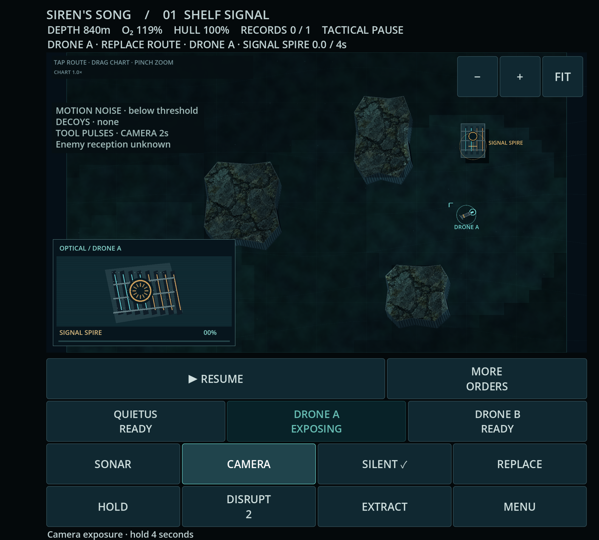

# Current playable status

Latest successful inspected APK remains **0afe5fc**, [run39251216827](validation/android-39251216827/README.md). New chapter run39261365076 failed in the validation helper before chapter injection; [all artifacts and the black resume frame are retained](validation/android-39261365076/README.md). Its APK is not promoted.

The relative-path helper correction, reviewed [loadout clarity](reviews/2026-10-19-loadout-clarity-review.md), and readable settling hint pass the combined local gate. [Native39266427532](validation/android-39266427532/README.md) is now running on exact20de5cd. More loadout scrolling remains a cost. In parallel, matched motion shows an isolated steering challenger clearing a previously failed basalt departure; [experience](reviews/2026-10-19-navigation-departure-experience.md) and [regression](reviews/2026-10-19-navigation-departure-regressions.md) support local integration, now passing combined checks. The change is not in the running APK candidate. Continuous development proceeds through these checkpoints.

# Siren's Song · current checkpoint

**[Latest inspected Android APK ·0afe5fc](https://github.com/pemunson90-cmd/Siren-s-Song/actions/runs/39251216827/artifacts/12186710188)** · [Install/update guide](PLAYTEST_ANDROID.md) · [Native evidence](validation/android-39251216827/README.md)

Active Gauntlet: the contact-feedback/capture cycle is verified within scope; the **direct Blackwater chapter has passed independent desktop review**, with native validation next and isolated loadout clarity already underway. Checkpoints save progress while development continues. Only the user determines satisfaction and program termination.

## What you can inspect

[Cover restored dive](validation/android-39251216827/screenshots/cover-restored-gameplay.webp) · [Inner restored dive](validation/android-39251216827/screenshots/inner-restored-gameplay.webp) · [Cover-sized desktop contact/camera stress](validation/production/observed-contact-feedback/regression/three-contact-cover.png)

The first three are actual new Android screenshots. The stress image is a **desktop420dpi presentation fixture with synthetic cached contacts**, not a native encounter. [Byte/pixel review](validation/android-39251216827/ARTIFACT_REVIEW.md).

Watch the [16second baseline](validation/production/observed-contact-feedback/clips/baseline-response.mp4) and [challenger](validation/production/observed-contact-feedback/clips/challenger-response.mp4): a seen hunter becomes an aging echo, then a different patrol appears. Short S# tags match readable observed-role/age rows; long text no longer covers the archive label. Rows add chart coverage and require eye travel. [Independent experience review](reviews/2026-10-19-observed-contact-feedback-critique.md).

[Second decoy during an existing lock](validation/production/observed-contact-feedback/clips/existing-lock-loss.mp4) still ends in loss while transmissions remain active. This desktop counterexample does not promise universal decoy failure or expiry-means-safety. The launch footer now accurately describes a historical event. Hidden enemy reactions remain unknown.

## What the new build proves

Run39251216827/source0afe5fc (reviewed game/tool source5eb571f) passes both layouts' geometry, scrolling/Settings, zoom/pan/FIT, lifecycle/audio, ordinary Shelf completion/cold restoration and fixture-assisted Well response/return with the genuine archive restored. All four ZIP hashes/CRC, APK hash and v2/v3 signing certificate verify, independently recomputed by root. All41 final screenshots were inspected. Camera/restored-dive images now show their named states; app post-draw diagnostics still do not acknowledge the Android compositor.

APK SHA256 begins `c8b63d1bddee`; certificate matches retained builds. [Exact hashes/artifacts/scope](validation/android-39251216827/README.md). Separate [regression review](reviews/2026-10-19-observed-contact-regressions.md) finds no consequential new regression:518 matching state records and focused adversaries supplement actual captures. Test counts are not the game quality bar.

Native S# text appears only partially behind an ending/menu overlay in this protocol; an unobscured native fresh→echo/newcomer sequence and crowded optical/contact motion remain unproved. Current desktop evidence supports those bounded presentation gains. No full-game acceptance follows from the APK pass.

## Next gameplay cycle ·Blackwater

The [fresh campaign scout](reviews/2026-10-19-campaign-quality-scout.md) found genuine reconnaissance risk but generic rewards: Blackwater promises an exchange while giving two more similar photographs. [Baseline approach](validation/production/campaign-quality-scout/blackwater-approach-16s.mp4) · [no-input exposure and real drone loss](validation/production/campaign-quality-scout/blackwater-noinput-16s.mp4).

The [actual matched experiment](validation/production/blackwater-exchange-prototype/motion/README.md) rejected mandatory transmission timing: it added about five seconds of waiting without demonstrated tactical benefit. The implementation now develops distinct retained request/reply evidence and a quiet-close versus audible-standoff sampling choice, preserving legacy active saves and finite tools. No new chapter APK is promoted yet.

Watch the current [baseline approach](validation/production/blackwater-motion-review/baseline-approach.mp4), [new request](validation/production/blackwater-motion-review/challenger-approach.mp4), [audible reply](validation/production/blackwater-motion-review/challenger-active-reply.mp4), [matched no-input control](validation/production/blackwater-motion-review/challenger-active-control.mp4) and [real idle-world drone loss](validation/production/blackwater-motion-review/challenger-idle-final.mp4). [Fresh experience review](reviews/2026-10-19-blackwater-direct-experience.md) supports scoped desktop promotion; [regression review](reviews/2026-10-19-blackwater-direct-regressions.md) verified the save-transition fix. These are desktop command-driven captures, not native chapter acceptance. New fixture-assisted native sampling/record/restoration/gallery checks failed before fixture generation on sourcea178825 in [Android39261365076](https://github.com/pemunson90-cmd/Siren-s-Song/actions/runs/39261365076); latest inspected APK above remains unchanged until actual artifact review.

Local direct-chapter checks now pass; [actual cover receiving](validation/production/blackwater-direct/layout-cover-receiving/full.png) and [earned request gallery](validation/production/blackwater-direct/layout-cover-gallery-request/full.png) are desktop420dpi fixtures using ordinary drone routes/sampling. They are **not Android screenshots or chapter promotion**. Matched motion, independent experience review and new scoped native checks are in progress. A real transition-save regression and receiving-label wrap were found and corrected; old failure evidence is retained.

The [independent adherence/progress audit](reviews/2026-10-19-gauntlet-adherence-progress-audit.md) found legitimate contact-feedback gains and corrected stale next-action records, while warning against over-certifying small presentation changes. The response is active chapter development, followed by fresh playable criticism—not another general audit.

## Preserved gains, losses and remaining bar

- [Previous inspected acoustic9dacbb4](validation/android-39244955064/README.md), [densityb809501](validation/android-39229219785/README.md), and [fully inspectedf1ea536/runtime92625ac fallback](validation/android-39205478335/README.md) remain available. Older pre-fix capture lag and patrol losses remain evidence, not current pixel claims or balance targets.
- [Original v7 import/audit](reviews/2026-10-19-original-prototype-mechanics-audit.md), [ratified role fixes](validation/production/siren-roles/README.md), [Cold Foundry encounter](validation/production/foundry/README.md), and [touch comparison/losses](validation/production/touch/README.md) are preserved. More controls and opaque instruments cost chart space and disclosure taps.
- [Baseline/experiment ledger](BASELINE_AND_EXPERIMENTS.md) retains rejected approaches. [Mark of the Ninja comparison](validation/reference-footage/CURRENT_ACCESS_2026-10-19.md) still leads on immediate spatial attention linkage. [Sustained Barotrauma comparison](validation/reference-footage/BAROTRAUMA_SONAR_DISCOVERY_2026-10-19.md) remains pending; accessible stills and a two-second trailer shot are insufficient.
- Physical Fold7 folding/cutouts/thumb comfort, OS multitouch pinch, sustained heat/performance, human listening/newcomer comprehension and earned full native campaign/finale remain open. The build includes unpromoted finale ancestry. User hands-on direction remains authoritative and does not gate routine continued work.

[Workbench](WORKBENCH.md) · [Exact continuation](CONTINUATION.md) · [Model/usage record](MODEL_USAGE.md) · [Source authority](SOURCE_AUTHORITY.md)
